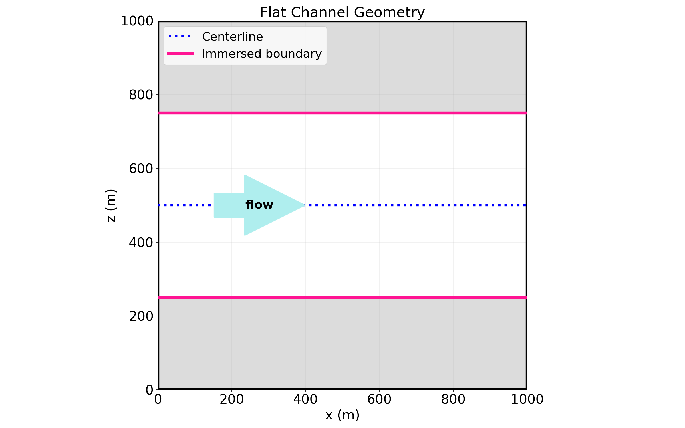
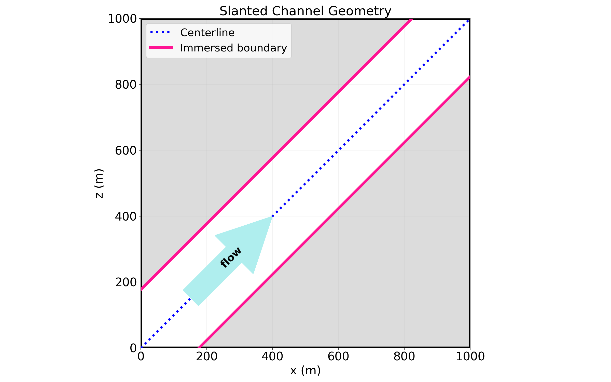

<!-- This file is compiled into the website through .website_src. -->

# Laminar channel flow with immersed boundaries

This verification case measures the spatial convergence of pressure-driven,
single-phase laminar channel flow. It verifies both a flat channel aligned to
cell faces and a $45^\circ$ slanted channel represented with
`ChannelBuilder` immersed boundaries. A non-immersed-boundary channel-flow
series provides a solver reference.





## Contents

- [Verification matrix](#verification-matrix)
- [Analytical solution](#analytical-solution)
- [Prerequisites](#prerequisites)
- [Generate solver inputs](#generate-solver-inputs)
- [Run the solver](#run-the-solver)
- [Analyze convergence](#analyze-convergence)
- [Outputs](#outputs)
- [Troubleshooting](#troubleshooting)

## Verification matrix

The supported matrix is deliberately small and fixed:

| Series | Geometry | Limiter | $N_x$ |
| --- | --- | --- | --- |
| Flat IB | Cell-face-aligned channel | `default`, `original` | 32, 64, 128, 256, 512, 1024 |
| Slanted IB | $45^\circ$ channel | `default`, `original` | 32, 64, 128, 256, 512, 1024 |
| Reference | No immersed boundary | Not applicable | 32, 64, 128, 256 |

This produces 28 runs: 24 immersed-boundary cases and four references. The
current temporal drag limiter is named `default`. `original` selects the original drag limiter for comparison.

Shared solver settings are in [base.inp](cases/base.inp), and geometry-specific
settings are in [flat-ib.inp](cases/flat-ib.inp),
[flat-no-ib.inp](cases/flat-no-ib.inp), and [slanted.inp](cases/slanted.inp).
Each generated case explicitly includes the shared settings first and its
geometry-specific settings second. The immersed-boundary inputs use the `default` drag limiter; generated
`original` cases override only the two drag-limiter switches.

## Analytical solution

For channel height $H$, viscosity $\mu$, and axial body-force magnitude
$F_\parallel$, the fully developed Poiseuille solution is

$$
u_\parallel(r) = U_{\max}\left(1 - \left(\frac{2r}{H}\right)^2\right),
\qquad
U_{\max} = \frac{F_\parallel H^2}{8\mu}.
$$

For a centerline with unit tangent $\boldsymbol{t}=(t_x,t_z)$, the analyzer
projects numerical velocity onto that tangent and calculates the perpendicular
distance using the in-plane unit normal
$\boldsymbol{n}=(-t_z,t_x)$. Error is evaluated for
$r < 0.6H$, which excludes artifacts from periodic companion segments in the
slanted geometry. The reported metric is relative $L_\infty$ velocity error;
the analyzer also reports the observed order between adjacent resolutions.

## Prerequisites

Use the case-specific `kynema-sgf-env` conda environment. It contains the
Python, NumPy, Matplotlib, and `yt` dependencies required by the generator
and analyzer.

From this directory, create the environment when necessary and activate it:

```bash
conda env create -f python/kynema-sgf-env.yml
conda activate kynema-sgf-env
```

An available Kynema-SGF executable is also required to run the generated
inputs. Solver launch and resource selection are intentionally controlled by
the user or the target HPC system.

## Generate solver inputs

Generate the complete matrix with:

```bash
python python/generate_cases.py
```

The command writes solver directories and a `manifest.json` file directly in
`cases/`. Each directory contains `inputs.inp`, which includes the checked-in
shared and geometry-specific inputs, then overrides `amr.n_cell` and, where
needed, the drag-limiter settings.

Inspect the planned matrix without writing files:

```bash
python python/generate_cases.py --dry-run
```

Target selected geometries, limiters, or immersed-boundary resolutions during
development:

```bash
python python/generate_cases.py --geometries flat --limiters default --resolutions 64,128
```

The generator does not replace existing cases by default. Use `--overwrite`
only after preserving any solver output that must be retained.

## Run the solver

Run the Kynema-SGF executable from every generated case directory with its
`inputs.inp` file. For example, after generating the full matrix:

```bash
cd cases/flat-default-n128
kynema-sgf inputs.inp
```

The solver must produce AMReX plot-file directories named `plt*` in the same
case directory. The analyzer selects the plot file with the largest numerical
suffix, so each run may retain intermediate outputs and checkpoints.

## Analyze convergence

After all selected solver jobs complete, run:

```bash
python python/analyze.py
```

The analyzer reads `cases/manifest.json`, validates each required velocity
component through `yt`, and loads each case's final plot file. Cases without
a plot file are reported and skipped, while malformed completed cases still
stop the analysis. Analyze a subset when iterating:

```bash
python python/analyze.py --geometries flat --limiters default
```

## Outputs

Analysis results are written to `cases/analysis/` by default:

- `error_summary.csv` contains the case metadata, selected plot file, sampled
  cell count, absolute and relative $L_\infty$ error, and observed order.
- `flat_convergence.png` compares the two flat immersed-boundary limiters.
- `slanted_convergence.png` compares the two slanted immersed-boundary limiters.
- `flat_convergence_with_reference.png` overlays the no-IB reference when the
  flat and reference series are both selected.

For a converged steady solution, the reference series should demonstrate the
expected second-order trend. The immersed-boundary series quantify how
alignment, orientation, and limiter selection affect that behavior.

## Troubleshooting

- **The generator refuses to write:** Existing case directories or a manifest
  were found. Preserve needed solver output, then rerun with `--overwrite`.
- **No plot file was found:** Run the solver in the generated directory and
  ensure at least one `plt*` output is present.
- **Velocity-field selection fails:** Inspect the field list reported by the
  analyzer. The selected Kynema-SGF build must expose one x, y, and z velocity
  field recognizable by `yt`.
- **No cells fall inside the error mask:** Verify that the input geometry,
  output plot file, and manifest refer to the same case matrix.